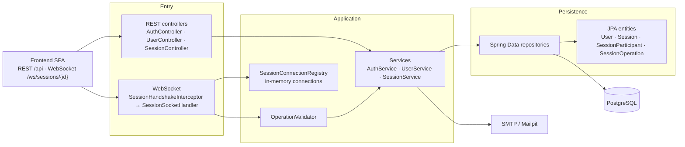

# Backend — layered architecture

A simplified view of `backend/blenderpds`: two entry points (REST and WebSocket) that share the
same business rules and the same persistence.

## What each layer does

| Layer | Responsibility | Does not |
|---|---|---|
| **Entry** — `controller/`, `websocket/`, `config/` | Turns HTTP/WebSocket into service calls, applies security (session, CSRF, origin) and the error format. | Business rules; direct database access. |
| **Application** — `service/` | Rules: who may join or end a session, nickname uniqueness, friend requests, ordering and deduplicating operations. | Know about `HttpServletRequest` or WebSocket frames. |
| **Persistence** — `repository/`, `model/` | Spring Data queries and JPA mapping. The operation log is the source of truth; `scene_snapshot` is a denormalisation. | Decide permissions or build HTTP responses. |

Cross-cutting: `dto/` exists only at the boundary (input and output), `ApiExceptionHandler`
turns exceptions into responses, and `SecurityConfig`/`JpaAuditingConfig` are configuration.

## Dependency rules

- Controllers and the WebSocket handler call **services**, never repositories.
- The WebSocket handler reuses the same `SessionService` as REST: join authorisation,
  persistence and session shutdown have a single implementation.
- Services know neither HTTP nor WebSocket. Session end is announced through
  `SessionEndedEvent`, and the handler listens for it to close the connections — no direct
  callback.
- `OperationValidator` runs before the service: the server validates, orders (`seq`) and
  stores the operation; the CRDT merge belongs to the client.
- `SessionConnectionRegistry` is process-local memory, which is why the backend runs as a
  single instance.

## Path of one operation

1. The client has already joined through REST (`POST /sessions/{id}/join`) and opened the socket.
2. `SessionHandshakeInterceptor` checks the session, the origin and the room membership.
3. `SessionSocketHandler` sends the message through `OperationValidator`.
4. `SessionService` persists it in `session_operations` (with a deduplicated `seq`) and returns
   the operations a reconnecting client is missing.
5. The handler fans out through `SessionConnectionRegistry` to the other participants.
