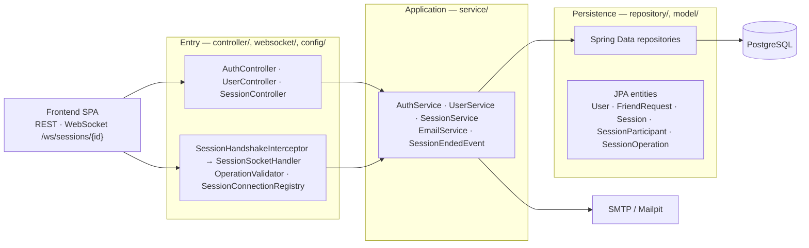

# Backend architecture

`backend/blenderpds` is a Spring Boot 4.1.1 service (Java 21) exposing two entry points — a REST
API and a native WebSocket endpoint — that share the same business rules and the same persistence.
It stores accounts, friendships and collaborative rooms; it never computes the 3D scene.

## Stack

| Piece | Choice |
|---|---|
| Framework | Spring Boot 4.1.1 (`spring-boot-starter-webmvc`), Java 21 |
| Security | Spring Security: HTTP-session login + CSRF, no JWT |
| Real time | `spring-boot-starter-websocket` (raw JSON frames, no STOMP) |
| Persistence | Spring Data JPA / Hibernate, PostgreSQL 16 (`compose.yaml`), `ddl-auto=update` |
| E-mail | Spring Mail → SMTP; in dev the recipient is the Mailpit from `compose.yaml` (UI on `localhost:8025`) |
| JSON | Jackson 3 (`tools.jackson`), shipped with Boot 4 |

## Layers

| Layer | Responsibility | Does not |
|---|---|---|
| **Entry** | Turn HTTP/WebSocket frames into service calls; apply security (session, CSRF, origin), validate the shape of socket payloads and hold the open connections. | Business rules; direct database access. |
| **Application** | Rules: who may join or end a room, one open room per host, e-mail confirmation, friend requests, ordering (`seq`) and deduplicating operations. | Know about `HttpServletRequest` or WebSocket frames. |
| **Persistence** | JPA mapping and the Spring Data queries. The operation log is the source of truth; `scene_snapshot` is a denormalisation. | Decide permissions or build responses. |

Dependency rules:

- Controllers and the WebSocket handler call **services**, never repositories.
- The socket handler reuses the same `SessionService` as REST: join authorisation, persistence and
  shutdown have a single implementation.
- Services know neither HTTP nor sockets. The end of a room is announced with
  `SessionEndedEvent`; the WebSocket layer listens (`@TransactionalEventListener`, after the
  commit) and drops the connections.
- `OperationValidator` runs before the service: the server validates, orders and stores. Merging
  the CRDT belongs to the client.
- `SessionConnectionRegistry` is in-process memory, which is why the backend runs as a single
  instance.

## REST surface

| Route | Purpose |
|---|---|
| `GET /auth/csrf` · `POST /auth/login` · `POST /auth/logout` | CSRF token, cookie login, logout |
| `POST /users` · `GET /users` · `GET/PUT/DELETE /users/{id}` | Registration and profile |
| `GET /users/confirm-email?token=` · `POST /users/{id}/confirm-email` | E-mail confirmation (clickable link, or direct for tests) |
| `POST/GET /users/{id}/friend-requests` · `…/sent` · `…/{requestId}/accept\|reject` · `DELETE …/{requestId}` | Friend requests |
| `GET /users/{id}/friends` · `DELETE /users/{id}/friends/{friendId}` | Confirmed friends |
| `POST /sessions` · `GET /sessions/{id}` · `GET /sessions/code/{code}` · `GET /sessions/open/{userId}` | Room lifecycle and lookup |
| `POST /sessions/{id}/join\|leave\|end` · `GET /sessions/{id}/participants` | Participation |
| `GET /sessions/friends/{userId}` | Friends' live rooms — the "hosting" badge |
| `GET /sessions/{id}/state` | Last stored scene snapshot |

Who acts comes in the body/path (same convention the friends API already used), so access depends
on Spring Security's authentication plus the service's friendship check. Collaborative operations
do **not** travel over REST — only the socket carries them.

## WebSocket

Route: `/ws/sessions/{id}?userId=` (native WebSocket, no STOMP; the Vite proxy forwards `/ws` in
dev). The gate is `SessionHandshakeInterceptor`, which runs **before** the upgrade: a non-friend
never gets a connection. It marks the participant connected inside the same locked transaction, so
two simultaneous handshakes cannot both slip past the participant limit.

Client → server: `sync_hello {vv}`, `sync_ops {ops}`, `presence`, `chat`, `scene_snapshot`.
Server → client: `sync_ops {ops}` (catch-up and relay, ops carry `seq`), `sync_ack`, `session_roster`,
`presence`/`chat` (relayed only, never stored) and `error {code}`. Unknown types are ignored by old
clients because every listener switches on `type`.

Two rules make it correct:

- **Ordering.** Storing and relaying happen inside the same per-session lock, so the `seq` order and
  the delivery order are identical — an operation that depends on another (moving an object someone
  else just created) never arrives first and is never dropped by the client.
- **Catch-up.** A new connection starts "catching up": frames that arrive before its initial log was
  flushed wait in a queue (`SessionConnection`) and are delivered right after it.

Limits enforced here: `OperationValidator` mirrors `frontend/src/collab/validate.ts` (shape and size
before anything is persisted; invalid operations are dropped, not fatal), rooms cap at
`MAX_PARTICIPANTS = 4`, and the snapshot is capped at `MAX_SNAPSHOT_BYTES` (1 MB).

## Data model

| Table | What it holds |
|---|---|
| `users` | account: unique e-mail (the login username), password hash, role, `email_verified`, confirmed `friendList` (`user_friends`, N:N) |
| `friend_requests` | only the PENDING state; the row is deleted on accept/reject/cancel |
| `sessions` | host, `status` (WAITING/ACTIVE/ENDED), shareable `code`, opaque `scene_snapshot`, timestamps |
| `session_participants` | one row per (session, user) with `active` + `last_seen_at` — presence has state, which is why it is an entity and not a `@ManyToMany` |
| `session_operations` | the append-only log: `seq`, `site_id`, `lamport`, `author`, `kind`, `payload` (raw JSON) |
| `email_confirm_tokens` | registration token, consumed on confirmation |

Two unique constraints carry the idempotency: `(session_id, seq)` is the server's total order and
`(session_id, site_id, lamport)` makes a resent operation (reconnect, retry) a no-op. The server
never interprets the payload: that is why a client that grows a new operation kind does not break
the backend.

## Authentication and security

`POST /auth/login` (e-mail + password) stores the Spring Security context in the HTTP session; the
browser then sends the JSESSIONID cookie by itself — including on the WebSocket upgrade, which is
the whole reason the login is cookie-based: no browser API can set a header on a handshake.
Mutations need the CSRF token from `GET /auth/csrf`, echoed in the header that endpoint advertises.
Registration is public but the login stays blocked (`UserDetailsServiceImpl` builds the account as
disabled) until the e-mailed confirmation link is clicked. The WebSocket upgrade additionally
checks the origin against `app.ws.allowed-origins`.

## Errors

`ApiExceptionHandler` maps service exceptions to one JSON shape (`{status, error, message}`): not
found → 404, invalid input → 400, conflicting state → 409, domain access rule → 403, unique
constraint on insert → 409. Messages are deliberately generic and in English — they are what the UI
shows, so database or parser internals never leak through them.

## Known limits

- The connection registry is in-process: one backend instance. Horizontal scaling needs a broker
  instead of `SessionConnectionRegistry`.
- The actor arrives as `?userId=` / `{id}` in the path. When the domain adopts the authenticated
  principal, the cookie already carries it.
- Plain "online" (idle, not hosting) has no presence source, so a friend is either hosting or
  offline.
- Nothing rehydrates a room from `scene_snapshot` yet: reopening still replays the log.
