# Diagramas — collab3d (estado v0.4)

Diagramas para a apresentação de PDS, gerados a partir do código em HEAD. Cada figura
existe em `.mmd` (fonte), `.svg` (vetor) e `.png` (2400 px de largura, fundo branco).

## Convenção de cores

| Cor | Significado |
|---|---|
| Azul | **frozen-spot**: parte fixa do framework |
| Amarelo | **hot-spot**: SPI/ponto de variação que a aplicação implementa |
| Verde | **app design-editor**: kinds, ferramentas, projeção |
| Cinza | **infraestrutura externa** (PostgreSQL, Mailpit, three.js, Spring Boot) |

## Como renderizar de novo

```bash
npx --yes @mermaid-js/mermaid-cli@11.12.0 -i docs/diagrams/src/a1-camadas.mmd \
  -o docs/diagrams/out/a1-camadas.svg -b white -w 2400
npx --yes @mermaid-js/mermaid-cli@11.12.0 -i docs/diagrams/src/a1-camadas.mmd \
  -o docs/diagrams/out/a1-camadas.png -b white -w 2400
```

O mmdc precisa de um Chromium; sem ele, use o mesmo bloco Mermaid em
<https://mermaid.live> (exportar PNG/SVG). Os PNGs entregues foram normalizados para
2400 px de largura e fundo branco com Pillow quando o mmdc gerou menos que isso.

## Índice

| # | Diagrama | Fonte | Imagem |
|---|---|---|---|

| A1 | A1 — visão em camadas | [src/a1-camadas.mmd](src/a1-camadas.mmd) | [SVG](out/a1-camadas.svg) · [PNG](out/a1-camadas.png) |

| A2 | A2 — arquitetura do backend | [src/a2-backend.mmd](src/a2-backend.mmd) | [SVG](out/a2-backend.svg) · [PNG](out/a2-backend.png) |

| A3 | A3 — arquitetura do frontend | [src/a3-frontend.mmd](src/a3-frontend.mmd) | [SVG](out/a3-frontend.svg) · [PNG](out/a3-frontend.png) |

| A4 | A4 — fluxo de uma operação colaborativa | [src/a4-fluxo-operacao.mmd](src/a4-fluxo-operacao.mmd) | [SVG](out/a4-fluxo-operacao.svg) · [PNG](out/a4-fluxo-operacao.png) |

| A5 | A5 — conexão e catch-up | [src/a5-conexao-catchup.mmd](src/a5-conexao-catchup.mmd) | [SVG](out/a5-conexao-catchup.svg) · [PNG](out/a5-conexao-catchup.png) |

| B1 | B1 — domínio JPA | [src/b1-dominio.mmd](src/b1-dominio.mmd) | [SVG](out/b1-dominio.svg) · [PNG](out/b1-dominio.png) |

| B2a | B2a — SPIs de sincronização e mensagens | [src/b2-spis-sincronizacao.mmd](src/b2-spis-sincronizacao.mmd) | [SVG](out/b2-spis-sincronizacao.svg) · [PNG](out/b2-spis-sincronizacao.png) |

| B2b | B2b — SPIs de validação de kind e conexão | [src/b2-spis-conexao-validacao.mmd](src/b2-spis-conexao-validacao.mmd) | [SVG](out/b2-spis-conexao-validacao.svg) · [PNG](out/b2-spis-conexao-validacao.png) |

| B3 | B3 — WebSocket | [src/b3-websocket.mmd](src/b3-websocket.mmd) | [SVG](out/b3-websocket.svg) · [PNG](out/b3-websocket.png) |

| B4 | B4 — CRDT e sincronização no cliente | [src/b4-crdt-sync.mmd](src/b4-crdt-sync.mmd) | [SVG](out/b4-crdt-sync.svg) · [PNG](out/b4-crdt-sync.png) |

| B5a | B5a — composição e render | [src/b5-render-core.mmd](src/b5-render-core.mmd) | [SVG](out/b5-render-core.svg) · [PNG](out/b5-render-core.png) |

| B5b | B5b — ferramentas, comandos e formatos | [src/b5-editor-app.mmd](src/b5-editor-app.mmd) | [SVG](out/b5-editor-app.svg) · [PNG](out/b5-editor-app.png) |


## A1 — visão em camadas

Direção única de dependência: app → framework → infraestrutura. A regra “framework não importa apps” é imposta por `check-boundaries.mjs` e `check-no-domain-kinds.sh`.

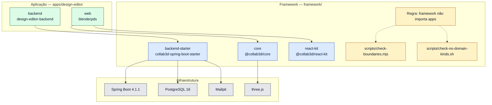


## A2 — arquitetura do backend

Entrada REST/WebSocket, handlers, autoridade (validação, admissão, sequenciador) e persistência. HS1/HS2/HS5 marcam onde as SPIs de variação entram.

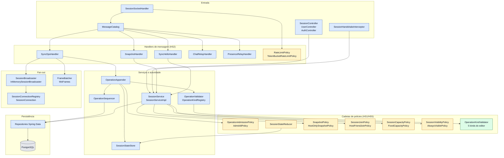


## A3 — arquitetura do frontend

`createCollabApp` é a raiz de composição: monta cena, `SyncEngine`, réplica e presença; o app registra kinds, ferramentas, comandos e formatos.

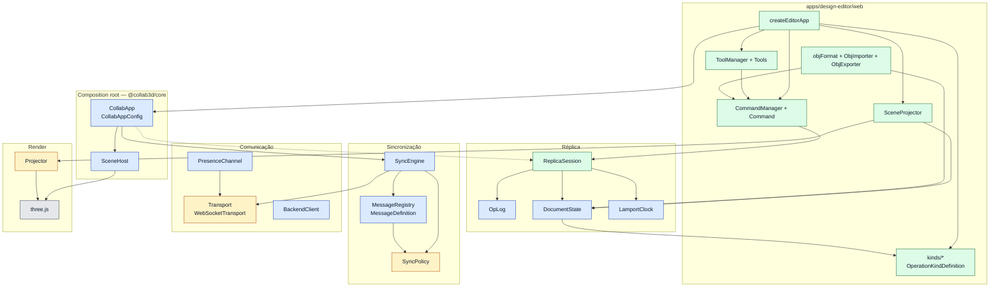


## A4 — fluxo de uma operação colaborativa

Do arraste ao broadcast, incluindo rejeição por envelope/kind (`INVALID_OP`), recusa de admissão (`OP_REJECTED`) e a isenção de `sync_ops` no rate limit.

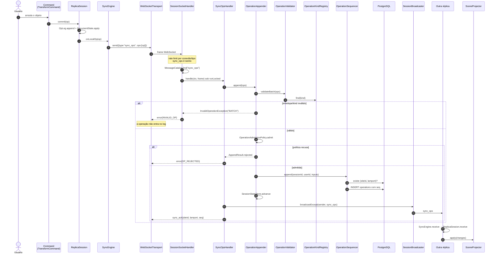


## A5 — conexão e catch-up

Login por cookie, handshake com `Principal`, políticas de entrada, `sync_hello`, `sync_snapshot` + operações paginadas por bytes e o snapshot periódico do host.

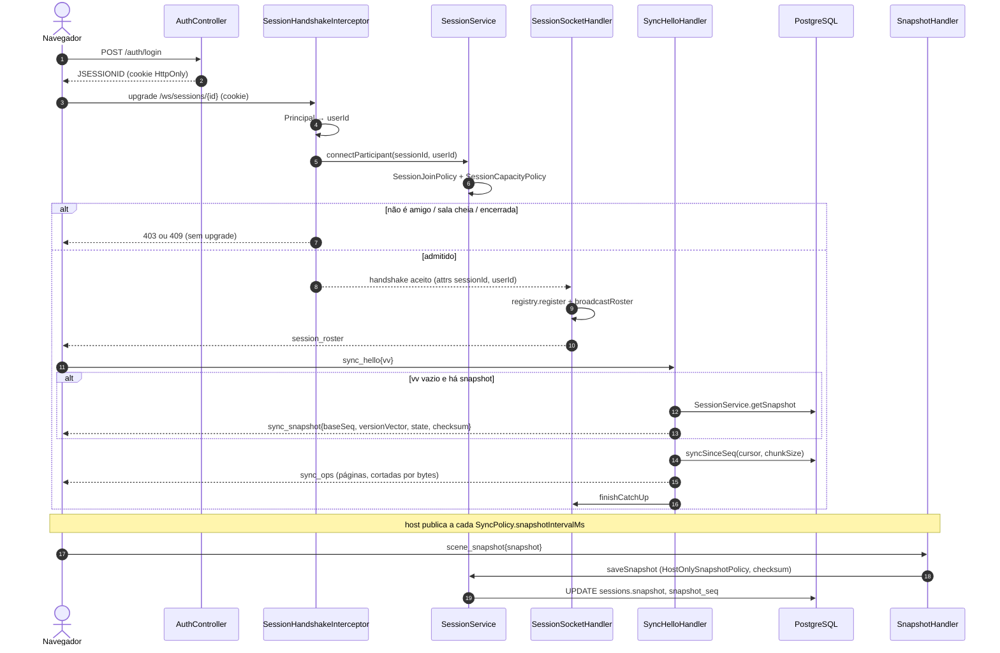


## B1 — domínio JPA

Entidades, enums e cardinalidades reais. `User.friendList` é muitos-para-muitos; `SessionOperation.author` é opcional (o autor pode ser removido).

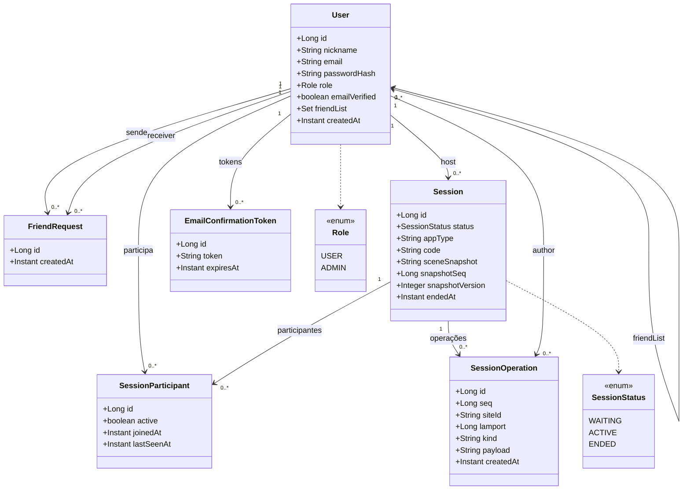


## B2a — SPIs de sincronização e mensagens

Interfaces de HS1/HS2/HS3/HS6, agrupadas por hot-spot via `namespace`, e as implementações default. `SessionStateReducer` e `MessageValidator` não têm implementação no app.

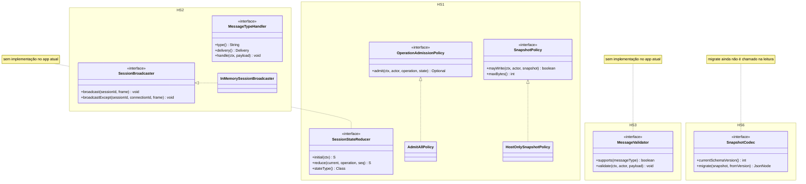


## B2b — SPIs de validação de kind e conexão

Os cinco validadores do editor (HS3), as políticas de entrada/capacidade/visibilidade (HS5), rate limit (P3.4) e `ServerOperationEmitter` (sem implementação).

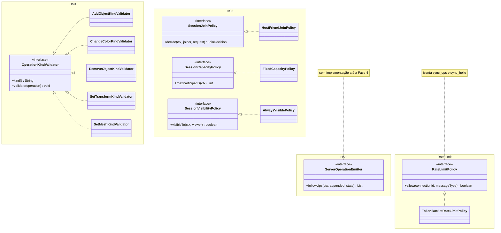


## B3 — WebSocket

Despachante, catálogo, handlers, validação de operações e registry de conexões. `FrameBatcher` corta frames por bytes antes do broadcast.

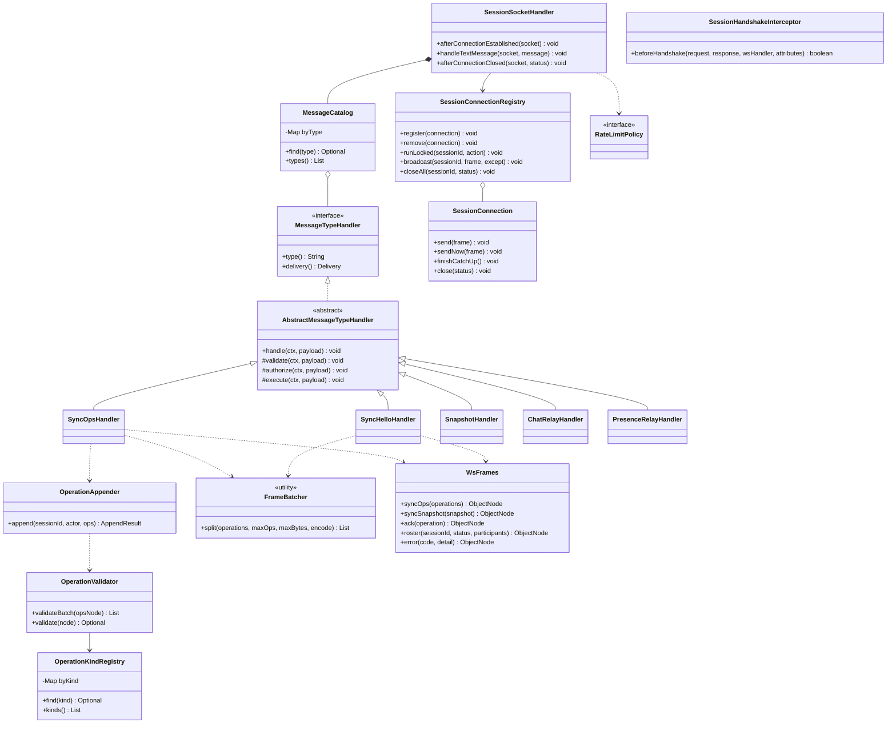


## B4 — CRDT e sincronização no cliente

Peças da réplica (`OpLog`, `DocumentState`, `LamportClock`), estratégias de merge, protocolo (`MessageRegistry`) e presença. `LwwStrategy`/`TombstoneSetStrategy` são objetos constantes.

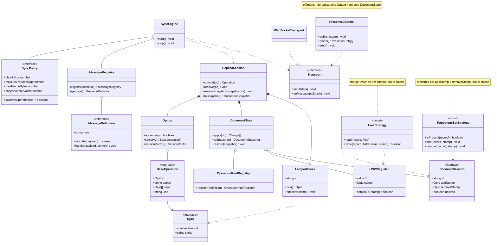


## B5a — composição e render

`CollabApp`/`CollabAppConfig`, `SceneHost` e o contrato `Projector`; `SceneProjector` é a projeção do editor e não declara `implements Projector`.

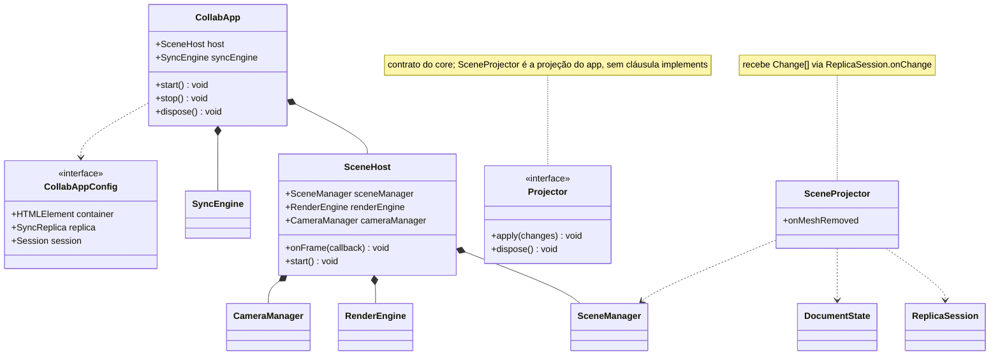


## B5b — ferramentas, comandos e formatos

`Tool`/`ToolManager`, `Command` e implementações, `CommandManager` e o registro de formatos com OBJ. `MeshProjector`, `ToolRegistry` e `InteractionRule` não existem no código.

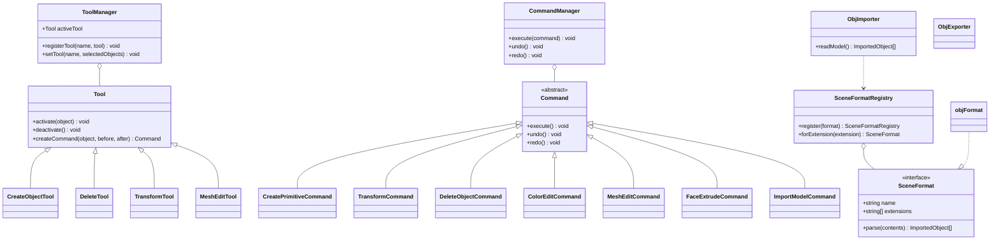


## O que foi omitido de propósito

- `MeshProjector`, `ToolRegistry`, `InteractionRule`, `CommandFactory`, `PayloadCodec` e a interface `MergeStrategy`: não existem no código; o que existe é `SceneProjector`, `ToolManager`, `Command`/`CommandManager` e `LwwStrategy`/`TombstoneSetStrategy` (objetos constantes).
- `SessionStateReducer`, `MessageValidator` e `ServerOperationEmitter` aparecem como SPI sem implementação; `SnapshotCodec` existe, mas `migrate` ainda não é chamado na leitura.
- Composição só aparece quando há campo/coleção real; `SyncEngine` depende de `ReplicaSession` sem possuí-la.
- `SceneProjector` implementa o comportamento de `Projector`, mas não declara `implements`; o diagrama usa nota em vez de seta de implementação.

## Verificação

- `docs/diagrams/verify.sh`: 100 nomes verificados, 0 inexistentes.
- Sintaxe: todos os 12 `.mmd` renderizados pelo mmdc 11.12.0.
