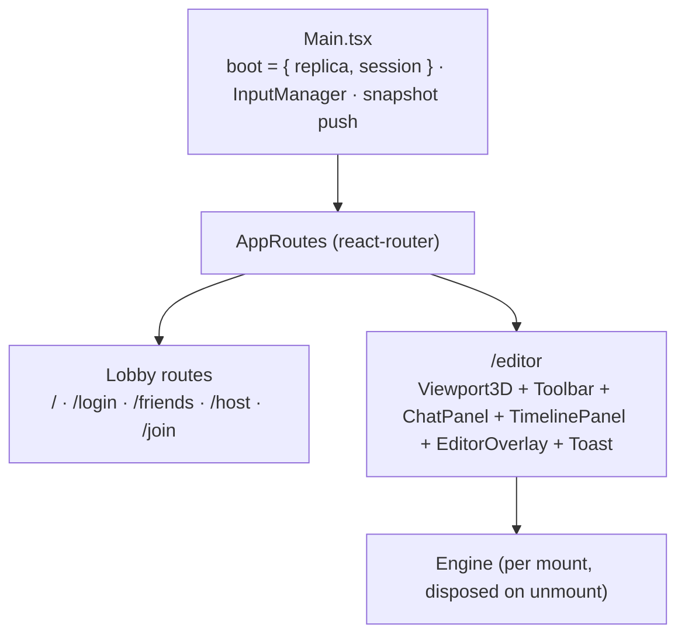
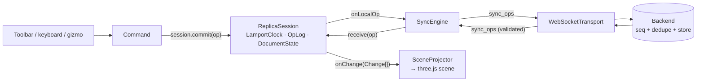

# Frontend architecture

`frontend` is a Vite + React 19 + TypeScript SPA on top of a three.js 0.161 editor. The editor
core is imperative (managers, controllers, tools, commands); React only hosts the lobby, the panels
and the 3D viewport. Collaboration is a client-side CRDT: the scene is a projection of an
operation log, and the backend only sequences and stores that log.

## Stack and entry

| Piece | Choice |
|---|---|
| App shell | React 19, react-router-dom 7 (`BrowserRouter`) |
| 3D | three.js 0.161 + `TransformControls`, `OrbitControls`, `OBJLoader` |
| Build | Vite 8, TypeScript (strict), `npm run build` = `tsc && vite build` |
| Real time | One `Transport` implementation: `WebSocketTransport` (JSON frames) |
| State | No store library: the CRDT (`ReplicaSession`) plus React state per screen |

`index.html` loads `src/Main.tsx`, the only entry point.

## App shell

A lobby page (Host/Join/Friends) builds the session — `Session { role, transport, sessionId?, userId? }`
— and calls `onStart`; `Main` creates the `ReplicaSession` (the replica lives for the whole
session) and the router fades to `/editor`. `Viewport3D` builds the `Engine` inside an effect and
disposes it on unmount (React StrictMode mounts twice in dev, so everything is detachable).
Leaving sends the final snapshot, then `POST /sessions/{id}/end` (host) or `/leave` (guest).

`InputManager` maps the keyboard to intent strings (`input:action` on the global bus); the bindings
live in `Main.tsx`: WASD/Space/Shift move the camera, `Tab` toggles edit mode, `G/R/C` pick a
transform tool, `Z/Y` undo/redo, `E` extrude, `P` split edge, `X`/`Del` delete. The client also
pushes a scene snapshot over the socket every 15 s (denormalisation only — the log stays the truth).

## Editor core

`Engine` is the composition root: it builds the managers, the controllers and — only inside a
session — the sync link, runs the render loop and disposes everything. It decides nothing about
what an input *means*; the controllers do.

| Group | Classes | Role |
|---|---|---|
| Managers | `SceneManager`, `RenderEngine`, `CameraManager`, `SelectionManager`, `RaycasterManager`, `ToolManager`, `CommandManager`, `EditorModeManager` | One concern each; `SceneManager` is the single owner of scene objects, the rest read from it |
| Controllers | `ActionRouter`, `SelectionController`, `TransformGestureController` | Turn bus events (toolbar clicks, keyboard, canvas clicks, gizmo drags) into commands or tool calls |
| Tools | `TransformTool`, `CreateObjectTool`, `DeleteTool`, `MeshEditTool` | Do the work on three.js objects; `MeshEditTool` works on a half-edge mesh (`mesh.userData.heMesh`) with a `SelectionStrategy` (vertex/edge/face) |
| Commands | `CreatePrimitiveCommand`, `DeleteObjectCommand`, `ColorEditCommand`, `TransformCommand`, `MeshEditCommand` | Make an edit undoable; the shared ones do it by **committing operations**, the local ones mutate directly |
| Entity | `EditorMode` (Object/Edit), `SelectionStrategy` (vertex/edge/face), `HalfEdge` mesh, `Navigation` (orbit/walk) | Domain concepts with no dependencies on React or the network |

`ActionRouter` is the single entry point for user intent: every action name has exactly one
handler, so nothing is wired twice.

## Collaboration (CRDT)

| Piece | Responsibility |
|---|---|
| `ReplicaSession` | Glue for one replica: clock + log + state. `commit()` is the local edit, `receive()` the remote one. |
| `LamportClock`, `OpId` | `OpId = { siteId, lamport }`; it is the identity of an operation and the CRDT's tiebreaker. |
| `OpLog` | Append-only list (the timeline) with de-duplication and the version vector used by the sync handshake. |
| `DocumentState` | The CRDT: per-field LWW registers (`transform`, `color`) plus add/remove stamps as tombstones. `apply()` returns only what changed; `replay()` rebuilds a past state from a log prefix. |
| `SceneProjector` | The only writer of shared content into the scene: turns `Change[]` into mesh add/remove/move/recolor and owns the `objectId ↔ Object3D` mapping. |
| `SyncEngine` | Announces the version vector (`sync_hello`), answers with the operations the other side lacks and broadcasts local ops one at a time. |
| `validate.ts` | Shape and size gate for anything off the network — the Java `OperationValidator` mirrors it. |
| `PresenceService` | Ephemeral "who has what selected", doubling as an advisory lock (simultaneous claims are broken by the lower `siteId`). Never in the log. |
| `RemoteSelectionView` | Draws the other participants' selections in the scene. |

Operation kinds accepted today: `add_object`, `remove_object`, `set_transform`, `change_color`.
`mesh_edit` and `undo` exist in `Operation.ts` as later stages and are rejected by `validate.ts`.

`WebSocketTransport` is the only `Transport`. It queues frames while the socket is down, reconnects
with backoff (5 attempts), and on reopen replays the last `sync_hello` before the queued
operations — a stale vector is harmless because the log drops duplicates.

## What is *not* shared

Two features stay local on purpose:

- **Imported OBJ models** (`ObjectParser` + `FileLoader`): they have no object id and never enter
  the log, so they are neither synced nor undoable.
- **Mesh editing** (`MeshEditTool`, `MeshEditCommand`, `FaceExtrudeCommand`): half-edge edits mutate
  geometry directly, so edit mode is a single-player tool until the `mesh_edit` operation lands.

Offline (`session = null`, the OFFLINE menu entry) uses the same engine with no sync link at all.
Colour preview while a slider is dragged is also local; releasing the picker commits one operation,
which is one undo step.

## UI layer

React components under `src/react/` talk to the engine only through the global `EventBus`
(`GLOBAL_BUS`, with `useBusEvent` in components and `BusSubscriptions` in the engine, so nothing
survives a dispose). `ChatPanel` shows the roster the backend pushes (`session_roster`) and relays
chat; `TimelinePanel` lists the log sorted by stamp and scrubs a prefix into a scratch
`DocumentState` (it reports counts, it does not rebuild the 3D past yet); `Toolbar`, `EditorOverlay`
and `Toast` emit intents and show feedback. The lobby screens (`Lobby`, `MenuPage`, `HostPage`,
`JoinPage`, social pages) own the REST calls in `src/api/Backend.ts`, including the CSRF token.

## Known gaps

- `AddObjectCommand` (`src/command/implementation/CreateObjectCommand.ts`) is dead code — the local
  (non-synced) create path it was written for is never instantiated, and the architecture diagram
  this document replaces still drew it.
- The timeline cannot render a historical scene, only counts.
- `deps` on operations is always empty: ordering relies on the server's `seq`, not on causal
  delivery.
