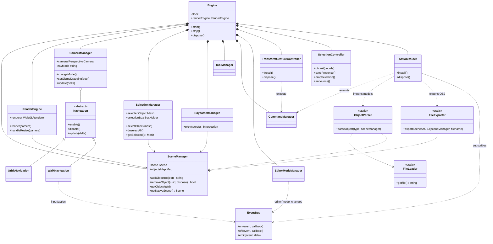
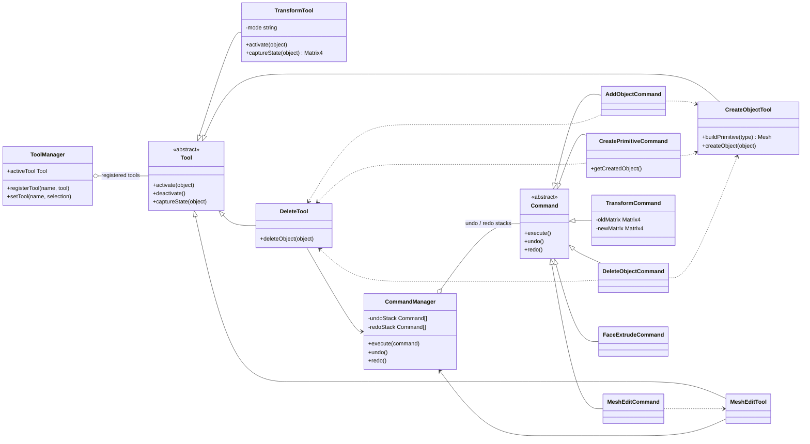
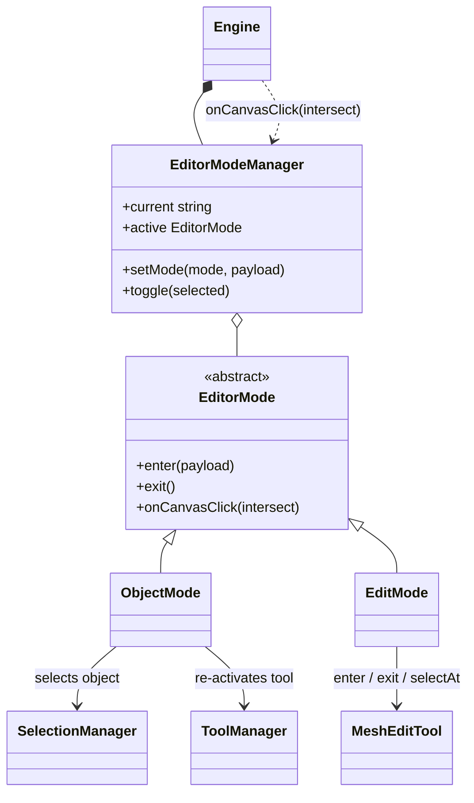
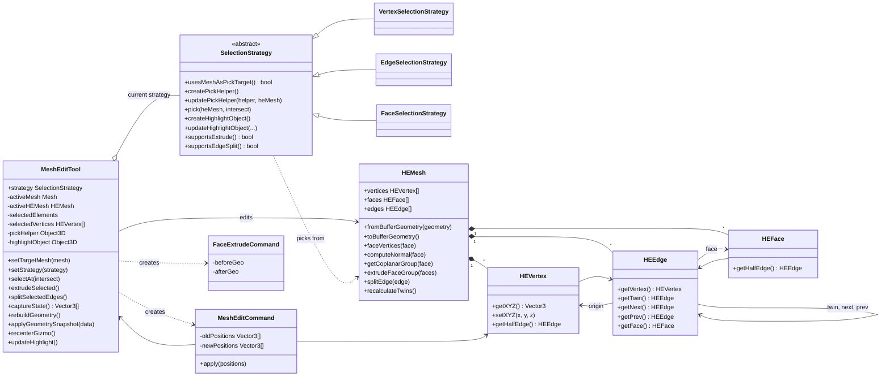

# BlenderPDS - Architecture (UML class diagrams)

Five views of the current code. Modules talk to each other in two ways: direct calls (solid/dashed arrows) and the global `EventBus` (`GLOBAL_BUS`), which decouples the UI, input and engine.

## 1. Engine and managers

`Engine` is the composition root: it builds and wires the subsystems, runs the render loop and disposes everything. It does not decide what an input means anymore; the controllers under `core/controllers/` do (`TransformGestureController`, `SelectionController`, `ActionRouter`). `SceneManager` is the single holder of scene objects, and the other managers read from it.



## 2. Tools and commands

A tool does the work, and a command makes it undoable. `ToolManager` holds the tools, and `CommandManager` holds the undo/redo stacks. Create and delete commands call the create/delete tools so that undo can reverse them. `CreateObjectTool` and `DeleteTool` also write to `SceneManager`, and `DeleteTool` uses `SelectionManager`.



## 3. Editor modes

`EditorModeManager` switches between object mode (select whole objects and use the transform gizmo) and edit mode (edit vertices, edges and faces). The active mode receives every canvas click that `Engine` picks.



## 4. Mesh editing domain

Edit mode works on a half-edge mesh stored in `mesh.userData.heMesh`. A selection strategy decides what a click picks (vertex, edge or face) and what the helper objects look like.



## 5. UI, input and networking

This view is React-first: there is no `UIManager` and no `Viewport` class. `Main.tsx` mounts
`AppRoutes`, which shows the lobby (`/`, `/login`, `/friends`, `/host`, `/join`) until a page
calls `onStart` with a `Session`; `/editor` then renders `Viewport3D`, the panels and the
overlay. `Viewport3D` is the only place that builds `Engine`, inside an effect, and disposes
it on unmount. The React UI and the engine talk to each other through `EventBus`.

Collaboration has exactly one transport: `WebSocketTransport`, created by `HostPage` (role
`host`) or `JoinPage`/`FriendsPage` (role `guest`). Its URL points at the backend socket
(`/ws/sessions/{id}?userId=`), so the server sequences and stores operations and relays
presence/chat. `Transport` stays as the interface because `SyncEngine`, `PresenceService`
and `ChatPanel` depend on it rather than on the socket.

```mermaid
classDiagram
direction LR

class Main {
    <<entry point>>
}
class AppRoutes {
    +renderEditor({ leave })
}
class Lobby {
    +onStart(session)
}
class HostPage {
    -startHosting()
}
class JoinPage {
    -join()
}
class FriendsPage {
    -join(friend)
}
class ChatPanel {
    -session Session
    -sendMessage()
    -setOnline(bool)
}
class Toolbar
class Viewport3D {
    -pointerDownCoords
}
class InputManager {
    -keybindings
    +init()
    +destroy()
}
class EventBus {
    +on(event, callback)
    +emit(event, data)
}
class Engine

class Session {
    +role SessionRole
    +transport Transport
    +sessionId number
    +userId number
}
class Transport {
    <<interface>>
    +send(data)
    +onMessage(callback)
    +onClose(callback)
    +close()
}
class WebSocketTransport {
    +urlFor(sessionId, userId) string
    +send(data)
    -open()
    -notifyClose()
}

Main --> AppRoutes : mounts
Main --> InputManager : keybindings
AppRoutes --> Lobby : no session yet
AppRoutes --> Viewport3D : /editor

HostPage ..> WebSocketTransport : creates
JoinPage ..> WebSocketTransport : creates
FriendsPage ..> WebSocketTransport : creates
HostPage ..> Session : host
JoinPage ..> Session : guest
FriendsPage ..> Session : guest

Viewport3D --> Engine : creates / disposes
Engine --> Session
ChatPanel --> Session
Session o-- Transport
Transport <|.. WebSocketTransport

Toolbar ..> EventBus : action:add_object, tool:change
Viewport3D ..> EventBus : ui:canvas_clicked
InputManager ..> EventBus : input:action
Engine ..> EventBus : subscribes
```
